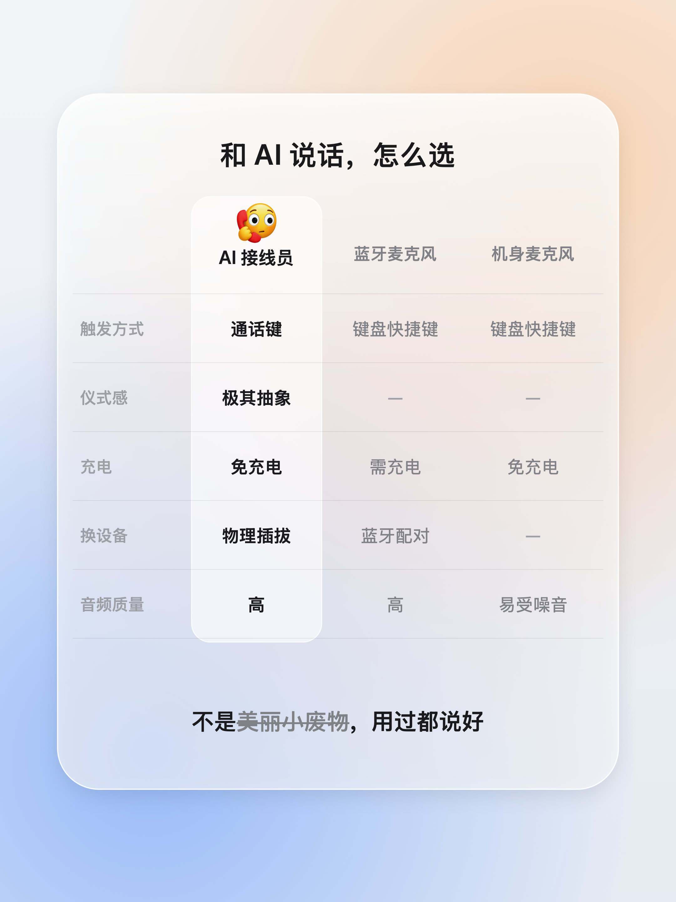

<div align="center">


# AI 接线员 · AI Commander

**用耳机上的「播放 / 暂停」键，一键接通你的 AI —— 开口说，文字直接落进光标。**

**随口说，出成稿** · 全程本地 · 为爱发电，永久免费


[](https://github.com/YuJonny/AI-Commander/releases)


⭐ **觉得有用，点个 Star 支持一下**

<sub>语音输入 · 本地语音识别 · 本地大模型 · 离线 · 媒体键映射 · push-to-talk · voice input · vibe coding · 接线员 · macOS · Windows</sub>

</div>

---

## 缘起

以前打电话，是一件很具体的事。

听筒有重量，电话线会绕在手边。号码拨出去以后，要等另一头有人接起。电话把相隔很远的两个人接在一起，声音从一根细细的线里传过来。

后来，电话被收进一块薄薄的屏幕里。我们不再守在电话旁，等一个人。听筒悄悄退场，成了电影里的道具。

我一直很喜欢那个简单的动作：拿起听筒，线路接通，然后开口。

在这个时代，要是还有这样一部电话呢？

过去，电话把人与人连接在一起。

现在，我们用它，和未来说话。

## 两个用它的理由

**1️⃣ 一点浪漫 ☎️**
在一个到处是冰冷界面的时代，它让你重新找回「拿起电话、和谁说说话」的那点仪式感。要是再配上一台复古电话听筒，**时代的反差感**会更迷人 —— 旧时代的躯壳里，住着这个时代最聪明的灵魂。

**2️⃣ 它是真的好用 —— 我称之为 Vibe Coding 的终极形态 🎯**
1. **无感** —— 拿起电话，按一下拨号键，就能直接开口；不用找窗口，不打断手头的事。
2. **免充电、免维护** —— 有线耳机不像蓝牙耳机要天天充电，没有续航焦虑，几乎零维护。
3. **切换极简** —— 换设备只需「一拔一插」，不必反复蓝牙配对。

---

## 核心卖点

### 🔒 全程本地 · 隐私保护 · 永久免费

语音识别、口语清理、可选的大模型润色，**全部在你自己的电脑上完成**。录音和文字不出本机，唯一一次联网，是你亲手点下「下载模型」的那一下。

核心逻辑开源，媒体键监听、键盘合成、模型下载、本地推理链路都可以自己审。永久免费。

### 🎙 两档语音识别，挑机型不挑人

机器性能各不相同，所以识别引擎不搞「一刀切」，下载时自己选：

| 档位 | 适合谁 | 特点 |
|---|---|---|
| **Qwen3-ASR · 高精度**（默认推荐） | 16GB 内存及以上，在意中英混说 | 约 840MB，中英混说更准，自带标点与大小写；峰值内存约 2.2GB |
| **SenseVoice · 轻量** | 8GB 内存 / 老机型 / 想更快更省 | 约 220MB，启动快、占用小 |

两档都按需下载。不用本地语音、只做按键映射时，一个都不用下。

### 🧠 可选的语义增强大模型：随口说，出成稿

想要更接近「成稿」的输出，可以再下载**语义增强大模型**（本地 Qwen3-8B，约 4.7GB）。它在**不改变你原意**的前提下，帮你收拾口语：

- 去掉「嗯、呃、那个」这类口水词；
- 处理自我更正：「三点，不对，两点半」→「2:30」；
- 合并重复表达，给长段补标点、必要时自动分点；
- 时间 / 日期 / 金额统一成书面格式。

这套润色**围绕中文口语、自我更正、数字保真、去重复做过专项优化**，并用真实中文对话语料回归验证过。它的目标不是替你发挥，而是把你已经说出口的话，整理得更清楚。可选，不需要时只用识别即可。

### 🧹 口语词自动过滤

即使不开大模型润色，AI 接线员也会做**确定性**的口语清理和技术热词纠正（GitHub、ChatGPT、TypeScript 这类常见词自动纠正大小写）。这一层用规则实现，优先保证稳定、绝不乱改。

### 💎 Liquid Glass 状态反馈

按下耳机键后，屏幕上出现一颗轻量的 Liquid Glass 胶囊，随时告诉你它在干什么：

`Listening 正在听` → `识别中` → `LLM 润色中`

出错也不让你猜：权限缺失、模型未下载、没听到声音、当前是密码框——都会明确提示。

### 🔁 也能接管你正在用的语音工具

已经在用别的语音输入软件？那就让 AI 接线员只做「耳机键 → 快捷键」。内置全套预设：

> 豆包输入法 · 微信输入法 · Typeless · 闪电说 · Wispr Flow · Superwhisper · AutoGLM · Claude Code · Codex

选中预设，耳机播放键就自动映射到对应工具的默认快捷键；也可以「自定义」，录制任意按键或组合键。

---

## 和 AI 说话，怎么选？

<div align="center">
  
</div>

|  | ☎️ AI 接线员 | 蓝牙麦克风 | 机身麦克风 |
|---|---|---|---|
| 触发方式 | **通话键，一按即说** | 键盘快捷键 | 键盘快捷键 |
| 仪式感 | **极其抽象（褒义）** | — | — |
| 充电 | **免充电** | 需充电 | 免充电 |
| 换设备 | **物理插拔** | 蓝牙配对 | — |
| 音频质量 | **高（贴嘴收音）** | 高 | 易受噪音 |

> 不是美丽小废物，用过都说好。

---

## 下载与安装

前往 [Releases](https://github.com/YuJonny/AI-Commander/releases/latest) 下载。

| 平台 | 文件 | 能力 |
|---|---|---|
| **macOS**（Apple 芯片） | `AI.Commander_Mac.dmg` | 本地语音输入 **＋** 耳机键映射 |
| **Windows** | `AI.Commander_Win.exe` | 耳机键映射 |

> 本地语音输入目前是 macOS（Apple Silicon）专属；Windows 版专注把耳机键映射成任意快捷键。

### macOS 首次打开

应用暂未做 Apple 公证，第一次打开可能提示「已损坏」或「来自身份不明的开发者」——这是未公证应用的常见提示，软件本身没问题。任选一种：

- **点几下鼠标**：双击 App → 打开「系统设置 → 隐私与安全性」→ 在「安全性」一栏点「仍要打开」→ 再确认一次。
- **一行命令兜底**：
  ```bash
  sudo xattr -cr /Applications/AI接线员.app
  ```

首次启动会引导你完成两项**必需**权限——**辅助功能**（监听耳机键、把文字送进当前 App）和**麦克风**（本地识别）——并可顺手检测一下耳机播放键。

### Windows 首次打开

- 未签名，**SmartScreen** 会拦一下：点「更多信息 → 仍要运行」。
- 杀毒软件可能因「键盘钩子」行为**误报**，加入信任 / 白名单即可。
- 单文件免安装，x64，Windows 10/11 双击即用，无需管理员权限、无需安装 .NET。

---

## 支持的语言

本地识别支持**中文、英语、日语、韩语、粤语**。当前重点优化**普通话中文与中英混说**；其他语言可以识别，润色效果建议按你的实际场景验证。

---

## 🧩 推荐搭配使用

- 🎙️ **[Typeless](https://www.typeless.com/?via=jonny)** —— 语音输入软件。不只是快速把语音转成文字，还会自动校准、去口语化，直接整理成结构化的输出。
- ☎️ **[Native Union 复古电话听筒](https://s.click.taobao.com/t?e=m%3D2%26s%3DwIrhGUcHebRw4vFB6t2Z2ueEDrYVVa6424t41fwIvtDRnNAdhLhtk430ZFekjizvxL1QHRKL8qiA5rFvxyOF9bwBMngvQdOvBQ7ZDE%2F6%2BIeRXNdY%2BjBkB5eYDQwFj6yC8kftjCRdkjx9Tuff7Tu%2FYJiUD8YEbaigH9ofgWr0NEuwIB%2BqTHya4ovEYPUpsQ%2FF2%2BRbLWXc2uZ5pCmcDdfSii21iRm1aQiYoGwWYjQ2nPkzWlhic%2BUoh0NEJ7GOeqvGxg5p7bh%2BFbQ%3D)** —— Apple Store 入驻产品，市面上质感最好的复古听筒。我试过各种价位的，只有它的线材拉扯时几乎毫无阻力，外形也很适合桌面搭配。

---

## 隐私说明

AI 接线员需要两项系统能力：全局监听耳机播放/暂停键，以及向当前 App 合成键盘输入。正因为这听起来敏感，项目选择**开源**。

- 只处理你**主动按下**的耳机播放键，不读取你的键盘输入，不记录你在写什么；
- 文字通过系统键盘事件写入，**不碰剪贴板**，不污染剪贴板历史；
- 语音与文本处理**全程本地**，模型下载由你点击触发。

---

## 从源码构建

macOS（需要 Xcode 命令行工具，Apple Silicon）：

```bash
./build.sh          # 编译 arm64 + 签名 → AI接线员.app
```

本地语音引擎依赖的 sherpa-onnx / llama.cpp 运行时为 arm64，因此 macOS 本地语音版本需要 Apple 芯片。

Windows（需要 .NET 8 SDK）：

```bash
cd Commander-Windows
dotnet publish -c Release -r win-x64 --self-contained true -p:PublishSingleFile=true
```

---

## 第三方组件

- 语音识别：[sherpa-onnx](https://github.com/k2-fsa/sherpa-onnx) · Qwen3-ASR · SenseVoice · CT-Transformer 标点模型
- 本地大模型润色：[llama.cpp](https://github.com/ggml-org/llama.cpp) · Qwen3-8B
- Windows UI：WPF-UI · H.NotifyIcon.Wpf
- macOS 主体：SwiftUI · AppKit · CoreGraphics · AVFoundation

详见 [THIRD_PARTY_NOTICES.md](THIRD_PARTY_NOTICES.md)。

---

## License

[MIT](LICENSE) © 2026 Jonny Yu
